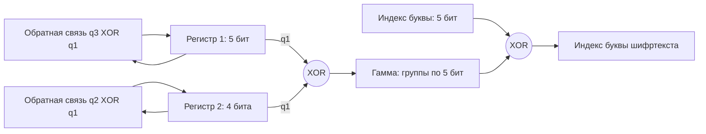

# ЛР8: генератор гаммы на системе РСЛОС, Go

Программа шифрует фразу «Нужна только одна паршивая овца, чтобы испортить все стадо.» по теме 8: два регистра сдвига с линейной обратной связью вырабатывают битовую гамму, которая накладывается на пятибитные коды букв через XOR. Есть расшифрование, карточка с ключом, таблицы состояний, гистограммы и тесты. Зависимости — только стандартная библиотека Go.

Вариант **1** принят по уточнению пользователя. Для задания 1 построен отдельный четырёхбитный регистр с периодом 15. Для шифрования фразы выбрана система с периодом 465 бит; она не называется системой с точным периодом 38 из задания 2. Причина описана ниже.

## Запуск

Нужен Go 1.22 или новее. Команды выполняются в каталоге репозитория.

```console
go run ./cmd/lab8
```

Программа создаст каталог `results/` с результатами и выведет шифртекст и результат расшифрования. Для сохранённого примера см. [examples/report.md](examples/report.md).

```console
go run ./cmd/lab8 encrypt -text "Нужна только одна паршивая овца, чтобы испортить все стадо." -out card.json
go run ./cmd/lab8 decrypt -in card.json
go run ./cmd/lab8 decrypt -in card.json -out decrypted.txt
```

Для текста из UTF-8 файла:

```console
go run ./cmd/lab8 encrypt -in message.txt -out card.json
```

Для дополнительного шифртекста при гистограммном анализе:

```console
go run ./cmd/lab8 demo -out results -compare cipher1.txt -compare cipher2.txt
```

Файлы сравнения содержат только буквы алфавита ниже, без внутренних пробелов и знаков препинания. Конечный перевод строки допускается. Программа сравнивает каждую диаграмму с открытым текстом и выбирает наиболее ровную среди переданных шифртекстов. Для разных алфавитов потребуется другая таблица частот.

Сборка и проверки:

```console
go build -o lab8.exe ./cmd/lab8
go test -cover ./...
go vet ./...
```

В Linux/macOS имя выходного файла можно заменить на `lab8`. Дополнительная проверка случайных входов:

```console
go test -run=^$ -fuzz=FuzzCipherRoundTrip -fuzztime=10s .
```

## Результат для фразы

Нормализация: верхний регистр, `Ё → Е`, `, → ЗПТ`, `. → ТЧК`, удаление пробельных символов. Получается 55 букв, 275 бит:

```text
НУЖНАТОЛЬКООДНАПАРШИВАЯОВЦАЗПТЧТОБЫИСПОРТИТЬВСЕСТАДОТЧК
```

Шифртекст с ключами по умолчанию:

```text
ЛЩЫНЧЗЗРЦАЫРКОСРФЛЕЧЮЕЫЗЖЧЪЯГТЯМЧЧГМПЮЖСАОЗКТЛВЦВЕИЩПАИ
```

Расшифрование возвращает нормализованный текст. Пробелы, регистр и исходная пунктуация не восстанавливаются: нормализация их не сохраняет, а буквосочетания ЗПТ/ТЧК могут встречаться и в самом тексте.

## Генератор и алфавит

Используется русский алфавит из 32 букв, как в методичке:

```text
АБВГДЕЖЗИЙКЛМНОПРСТУФХЦЧШЩЪЫЬЭЮЯ
```

Буквы нумеруются **от 0 до 31**, каждая занимает пять бит. Биты гаммы собираются в пятибитную величину от старшего к младшему. Шифрование и расшифрование выполняются одинаковой операцией: `result = letter_index XOR gamma`.

| Параметр | Регистр 1 | Регистр 2 |
|---|---|---|
| Строка таблицы П1.1 ЛР_8 | 7 | 5 |
| Многочлен | x⁵ + x² + 1 | x⁴ + x + 1 |
| Обратная связь | q₃ XOR q₁ | q₂ XOR q₁ |
| Маска скремблера | 00101 | 0011 |
| Начальный ключ | 10101 | 1001 |
| Период | 31 | 15 |

Клетки нумеруются **справа налево**, начиная с q₁. В строке состояния слева находится qₘ, справа q₁. Регистр выдаёт q₁ **до сдвига**. Новый бит обратной связи вставляется слева; остальные клетки сдвигаются вправо.

Конвенция многочлена задана рекуррентным соотношением: для `p(x)=x^m+Σ a_i x^i` новый бит — `b(t+m)=XOR a_i*b(t+i)`, i=0…m−1. В этой конвенции отвод для x^i — клетка q_(i+1), старший член x^m опускается при построении маски. Поэтому маска обратной связи — не механическая запись многочлена без свободного члена из PDF. Пример PDF со скремблером `101` и ключом `110` воспроизводится полностью: `110, 111, 011, 101, 010, 001, 100, 110`; ему соответствует многочлен №4 `x³+x²+1` в принятой конвенции.



Оба регистра сдвигаются на каждом такте. Период совместного состояния — `НОК(31, 15) = 465`. Программа **отдельно** измеряет минимальный период XOR-выхода: для этих ключей он тоже 465 бит. Такая проверка нужна, поскольку одинаковые регистры могут взаимно уничтожить выход через XOR.

Период последовательности пятибитных величин равен `465 / НОД(465, 5) = 93`. Для исходной фразы требуется только 275 бит. Программа проверяет более строгое условие `число букв × 5 ≤ битовый период`, чтобы гамма не оборачивалась внутри сообщения. С ключами по умолчанию допустимы до 93 букв включительно.

Можно выбрать другие проверенные многочлены: №3, 4, 5, 7, 13, 22, 41 из таблицы П1.1, степени 3–8. Длина ключа должна совпадать со степенью. Например, для более длинного сообщения:

```console
go run ./cmd/lab8 encrypt -in message.txt -poly1 13 -key1 110101 -poly2 22 -key2 1010011 -out card.json
```

При каждом создании регистра проверяется его максимальный период `2^m−1`. Одной неприводимости недостаточно: для М-последовательности нужен примитивный многочлен. Нулевые ключи, неизвестные символы и сообщение длиннее гаммы отклоняются.

## Вариант 1 и противоречие задания 2

В таблице 3 файла «Генератор гаммы РСЛОС» для варианта 1 стоят периоды **15 / 38**.

Задание 1 выполнено: регистр длиной 4 бита, многочлен №5 `x⁴+x+1`, начальный ключ `1001`, фактический период 15. Полная таблица — [examples/task1-variant1.csv](examples/task1-variant1.csv).

Задание 2 предлагает добавить ещё один четырёхбитный РСЛОС. Точный период 38 в этой конструкции невозможен. У каждого ненулевого четырёхбитного регистра не более 15 состояний; период системы равен НОК индивидуальных периодов, а период её XOR-выхода делит этот НОК. Число 38 содержит простой множитель 19. Чтобы он вошёл в НОК, период хотя бы одного регистра должен делиться на 19, что невозможно при 15 состояниях. Для двух примитивных четырёхбитных регистров период совместного состояния вообще равен 15.

Для практического шифрования построена система по схеме задания 2 с регистрами длиной **5 и 4** бита, которая имеет достаточный период. Система с точным периодом 38 не заявляется как выполненное задание. Вариант 18 в предоставленной таблице отсутствует; соответствие номера в списке варианту принято по уточнению пользователя.

Также сохранена таблица системы с длинами **4+4**, как в тексте задания 2: [examples/task2-variant1.csv](examples/task2-variant1.csv). Многочлены №5 и №5, ключи `1001/0101`, скремблеры `0011/0011`; фактический период состояния и выхода — **15**. Она показывает реализуемую конструкцию и не используется для длинной фразы.

## Отчёт и гистограммы

`demo` сохраняет:

- `card.json` — карточку с шифровкой, многочленами, скремблерами и начальными ключами;
- `plaintext.txt`, `ciphertext.txt`, `decrypted.txt` — нормализованный текст, шифровку и расшифрование;
- `task1-variant1.csv` — таблицу задания 1;
- `task2-variant1.csv` — таблицу конструкции 4+4 с фактическим периодом 15;
- `register1.csv`, `register2.csv`, `system.csv` — полные циклы состояний генератора для фразы с повторной начальной строкой;
- `encryption.csv` — индекс, битовый код буквы, гамму и результат для каждой позиции;
- `frequencies.csv` — число вхождений и частоту каждой буквы;
- `histograms.svg` — диаграммы с общей вертикальной шкалой;
- `report.md` — параметры, сравнение диаграмм и выводы.

Частота рассчитывается как `p_i = число вхождений / длина текста`. Отсутствующие символы остаются на диаграмме с нулевой частотой. Ровность оценивается суммой `Σ(p_i−1/32)²`: меньшее значение означает более ровную диаграмму. Также выводится энтропия `−Σp_i log₂p_i`. Максимум для 32 букв — 5 бит/символ.

Другие шифртексты курса и образец гистограмм не предоставлены. По умолчанию анализируется только пара «фраза — её шифртекст», без вывода о лучшем шифре всего курса. Дополнительные тексты передаются через `-compare`.

## Структура и тесты

- `lfsr.go` — многочлены, один регистр, два регистра и измерение периодов;
- `cipher.go` — подготовка текста, XOR, карточка и расшифрование;
- `analysis.go` — частоты, статистика и SVG;
- `report.go` — таблицы и отчёт;
- `cmd/lab8/` — команды программы;
- `*_test.go` — проверки алгоритма и команд.

Тесты проверяют пример из PDF, максимальные периоды **для всех ненулевых ключей** каждого поддерживаемого многочлена, уменьшение периода при взаимном уничтожении регистров, независимо рассчитанную шифровку фразы, JSON-карточку, обратное преобразование всех букв, границу длины гаммы, недопустимые ключи и символы, известные частоты и сохранённые таблицы. В GitHub Actions дополнительно запускается детектор гонок.

Это учебный потоковый шифр с детерминированной гаммой. Совершенный одноразовый блокнот Шеннона требует случайного одноразового ключа; линейная система РСЛОС такой гарантии не даёт. Ключи в примере и карточке опубликованы для воспроизводимости лабораторной работы.

## Источники

Параметры и задания взяты из предоставленных пользователем файлов «ЛАБКРИПТ_МиСКЗИ_2024.pdf», «Генератор гаммы РСЛОС (1).pdf» и «Таблица ЛР_8 (1).pdf». Сами учебные PDF в репозиторий не включены. Ссылка Moodle на варианты недоступна; для работы использована фраза из запроса пользователя.
