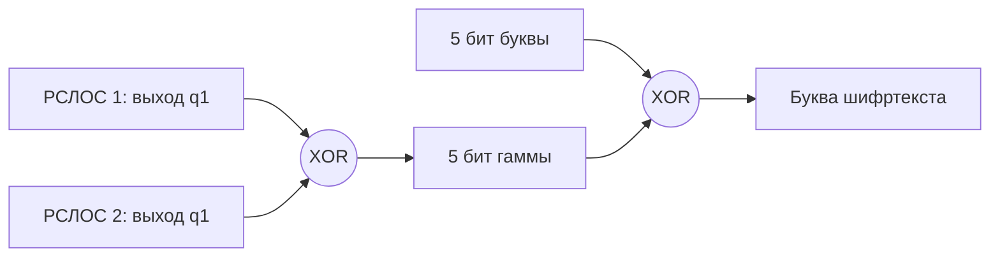
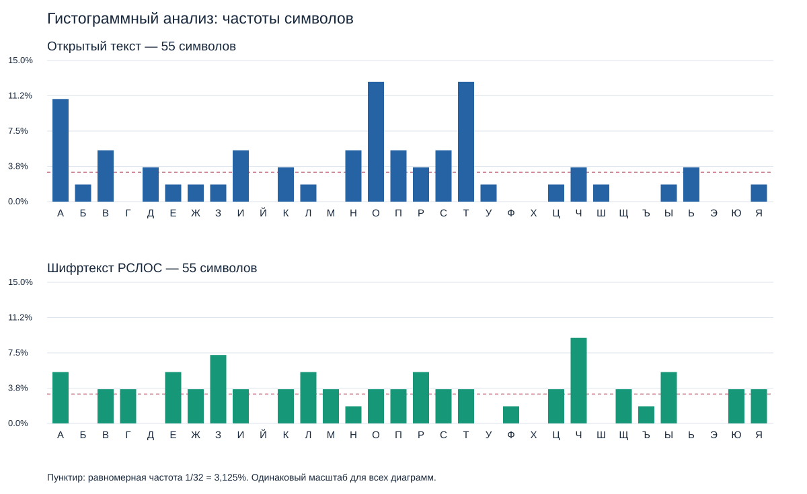

# Лабораторная работа 8. Гаммирование на системе РСЛОС

Вариант 1 принят по уточнению пользователя. Текст задан пользователем; файл вариантов из Moodle не использовался, так как ссылка недоступна.

## Текст и кодирование

Исходная фраза: Нужна только одна паршивая овца, чтобы испортить все стадо.

Подготовленный текст:

```text
НУЖНАТОЛЬКООДНАПАРШИВАЯОВЦАЗПТЧТОБЫИСПОРТИТЬВСЕСТАДОТЧК
```

Алфавит: `АБВГДЕЖЗИЙКЛМНОПРСТУФХЦЧШЩЪЫЬЭЮЯ`. Индексы 0–31 кодируются пятью битами, старший бит идёт первым. `Ё → Е`, `, → ЗПТ`, `. → ТЧК`; пробелы удаляются. Получено 55 символов, 275 бит. Расшифрование восстанавливает подготовленный текст.

## Задание 1, вариант 1

Таблица 3 задаёт период 15. Выбран многочлен №5 таблицы П1.1: `x^4+x+1`, скремблер `0011`, начальный ключ `1001`. Обратная связь: `q2 XOR q1`. Период проверен перебором: 15; полная таблица с повторным начальным состоянием — `task1-variant1.csv`.

## Задание 2: противоречие в условии

В таблице 3 для варианта 1 указано 38. Если к четырёхбитному регистру задания 1 добавить ещё один четырёхбитный РСЛОС, как требует текст задания, точный период 38 получить нельзя. У каждого ненулевого регистра не более 15 состояний; период совместного состояния при синхронных сдвигах равен НОК индивидуальных периодов. Чтобы он делился на 19, один из индивидуальных периодов должен делиться на 19, что невозможно. Период XOR-выхода делит период совместного состояния, поэтому тоже не может быть 38.

Для шифрования фразы ниже реализована система по схеме задания 2 с длинами 5 и 4 бита и достаточным периодом. Она не выдаётся за систему с точным периодом 38.

Построение с требуемыми длинами 4+4: оба многочлена `x^4+x+1`, скремблеры `0011/0011`, ключи `1001/0101`. Фактический период состояния и XOR-выхода — 15; таблица `task2-variant1.csv`. Для шифрования фразы эта короткая система не применяется.

## Генератор для шифрования фразы

| Параметр | Регистр 1 | Регистр 2 |
|---|---|---|
| Строка таблицы П1.1 | 7 | 5 |
| Многочлен | x^5 + x^2 + 1 | x^4 + x + 1 |
| Длина | 5 | 4 |
| Скремблер | `00101` | `0011` |
| Начальный ключ | `10101` | `1001` |
| Проверенный период | 31 | 15 |

Клетки нумеруются справа налево от 1 до m. Состояние записывается от q_m до q_1. Выходной бит снимается с q_1 до сдвига вправо. Для многочлена `p(x)=x^m+Σ a_i x^i` применяется рекуррентное соотношение `b(t+m)=XOR a_i b(t+i)`, где i=0…m−1. Поэтому коэффициент x^i соответствует клетке q_(i+1), а старший член x^m не включается в маску отводов. Единицы скремблера показывают физические клетки для XOR; результат входит в q_m.

Это явная конвенция расположения отводов: запись коэффициентов без свободного члена из текста PDF не следует автоматически использовать как битовую маску при сдвиге вправо. Пример PDF со скремблером 101 и ключом 110 точно воспроизводится; в данной конвенции ему соответствует `x^3+x^2+1` (№4).

Период совместного состояния: НОК(31, 15) = 465. Минимальный период выходной битовой гаммы отдельно проверен по всему циклу: 465. Период последовательности пятибитных величин: P / НОД(P, 5) = 93. Требуется 275 бит, поэтому гамма не успевает повториться.



Шифрование: `c_i = m_i XOR gamma_i`. Расшифрование: `m_i = c_i XOR gamma_i`. При расшифровании регистры запускаются заново с исходными ключами. Таблицы: `register1.csv`, `register2.csv`, `system.csv`; вычисления по каждой букве — `encryption.csv`.

## Карточка

Шифр: Шеннон/XOR, система двух РСЛОС.

Ключ: скремблеры `00101 / 0011`; начальные состояния `10101 / 1001`.

Шифровка:

```text
ЛЩЫНЧЗЗРЦАЫРКОСРФЛЕЧЮЕЫЗЖЧЪЯГТЯМЧЧГМПЮЖСАОЗКТЛВЦВЕИЩПАИ
```

Карточка с параметрами для расшифрования: `card.json`.

## Гистограммный анализ

Частота символа: `p_i = count_i / N`. Учитываются все 32 буквы, включая отсутствующие. Во всех диаграммах одна шкала; значения и количества приведены в `frequencies.csv`.



| Текст | N | Энтропия, бит/символ | Σ(p_i−1/32)² |
|---|---:|---:|---:|
| Открытый текст | 55 | 4.170684 | 0.037841 |
| Шифртекст РСЛОС | 55 | 4.483467 | 0.016684 |

Пара «открытый текст — Шифртекст РСЛОС»: диаграмма шифртекста ровнее (0.016684 против 0.037841).

Наиболее ровная диаграмма **среди предоставленных шифртекстов**: Шифртекст РСЛОС; критерий — минимальная сумма квадратов отклонений от 1/32.

Другие шифртексты и файл «Пример гистограммного анализа» не предоставлены. Поэтому вывод о лучшем шифре всего курса сделать нельзя. Дополнительные шифртексты можно добавить через повторяемый флаг `demo -compare file.txt`.

## Выводы

Система генерирует достаточную для фразы гамму; контрольное расшифрование совпало с подготовленным текстом. Перебор подтверждает периоды обоих регистров и отдельно XOR-выхода. На коротком тексте гистограмма не обязана быть равномерной: частотный анализ описывает данный образец, но не доказывает стойкость шифра.

Это учебное гаммирование с детерминированными РСЛОС, а не совершенный одноразовый блокнот Шеннона со случайным одноразовым ключом. Система из двух линейных регистров с XOR остаётся линейной. Начальные ключи в карточке опубликованы для воспроизводимости лабораторной работы.
